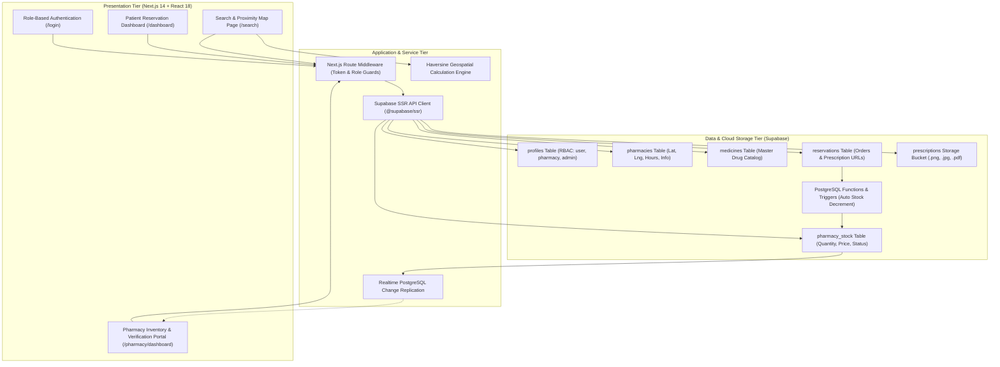
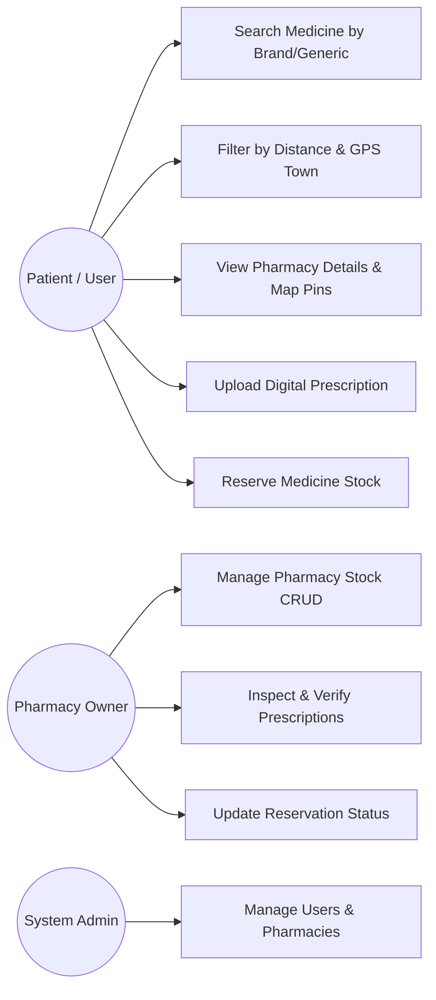
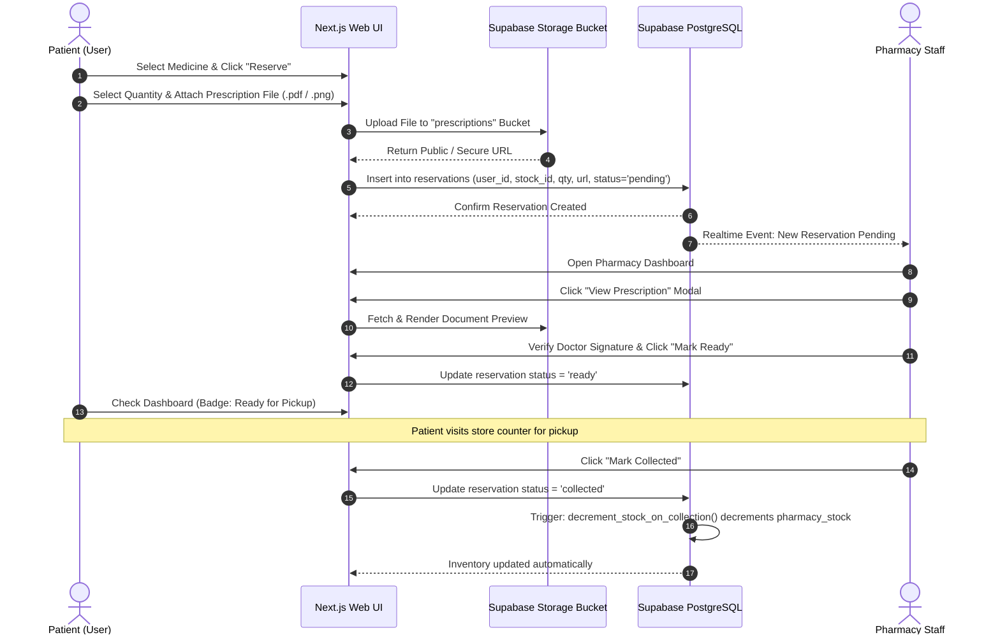

# MEDIFIND
## A Hyperlocal Medicine Availability Finder and Digital Prescription Platform

---

**A Mini Project Report Submitted in Partial Fulfillment of the Requirements for the Award of the Degree of**  
**MASTER OF COMPUTER APPLICATIONS**  
**of**  
**APJ ABDUL KALAM TECHNOLOGICAL UNIVERSITY (KTU)**  
**Course Code:** `20MCA245 MINI PROJECT`

---

### **Submitted by:**
**AFNAN ASHRAF K**  
**KTU Register Number:** `KITM25MCA-2004`  
**Academic Batch:** 2025 – 2027  

### **Under the Guidance of:**
**Asst. Prof. Mydhili Manoj**  
*Mini Project Guide & Assistant Professor*  
*Department of Computer Applications*  

### **Head of Department:**
**Asst. Prof. Jaseedha P P**  
*Head of Department, Department of Computer Applications*  

<p align="center">
  
</p>

**DEPARTMENT OF COMPUTER APPLICATIONS**  
**KMCT INSTITUTE OF TECHNOLOGY AND MANAGEMENT**  
**KUTTIPPURAM, MALAPPURAM, KERALA - 679571**  
**OCTOBER 2026**

---

## BONAFIDE CERTIFICATE

This is to certify that the project report entitled **"MEDIFIND: A Hyperlocal Medicine Availability Finder and Digital Prescription Platform"** is a bonafide record of the work carried out by **AFNAN ASHRAF K (Reg. No: KITM25MCA-2004)** under our supervision and guidance in partial fulfillment of the requirements for the award of the degree of **Master of Computer Applications** of **APJ Abdul Kalam Technological University** during the academic year 2025–2027.

| | |
| :--- | :--- |
| **Asst. Prof. Mydhili Manoj** | **Asst. Prof. Jaseedha P P** |
| *Mini Project Guide* | *Head of Department* |
| Department of Computer Applications | Department of Computer Applications |
| KMCT ITM, Kuttippuram | KMCT ITM, Kuttippuram |

<br><br>

| Internal Examiner | External Examiner |
| :--- | :--- |
| Name: _______________________ | Name: _______________________ |
| Signature: ____________________ | Signature: ____________________ |

---

## DECLARATION

I, **AFNAN ASHRAF K (Reg. No: KITM25MCA-2004)**, hereby declare that the mini project report entitled **"MEDIFIND: A Hyperlocal Medicine Availability Finder and Digital Prescription Platform"** submitted to the Department of Computer Applications, KMCT Institute of Technology and Management, Kuttippuram, under the guidance of **Asst. Prof. Mydhili Manoj**, is an authentic record of original work done by me.

I further declare that this report has not previously formed the basis for the award of any Degree, Diploma, Associateship, or Fellowship of any other University or Institution.

**Place:** Kuttippuram  
**Date:** October 24, 2026  
**AFNAN ASHRAF K**  
*(Reg. No: KITM25MCA-2004)*  

---

## ACKNOWLEDGEMENT

First and foremost, I express my profound gratitude to the Almighty for granting me the wisdom, strength, and perseverance to complete this mini project work successfully.

I express my sincere gratitude to **Asst. Prof. Jaseedha P P**, Head of the Department of Computer Applications, for her consistent encouragement, valuable recommendations, and for providing the institutional infrastructure and computing facilities necessary for this project.

I extend my deepest gratitude and heartfelt appreciation to my project supervisor and guide, **Asst. Prof. Mydhili Manoj**, Assistant Professor, Department of Computer Applications, for her insightful guidance, patient supervision, critical feedback, and constant encouragement throughout the entire duration of the project.

I also express my heartfelt thanks to all the faculty members and technical staff of the Department of Computer Applications, KMCT Institute of Technology and Management, for their timely assistance and cooperation during the project work.

Finally, I express my warmest thanks to my family, colleagues, and friends for their continuous moral support and understanding throughout my studies.

**AFNAN ASHRAF K**

---

## ABSTRACT

In semi-urban municipalities such as **Perinthalmanna** and **Valanchery** (Malappuram district, Kerala), finding critical medicines during healthcare emergencies often leads to severe distress. Patients and caregivers are routinely forced to visit multiple physical medical stores or make numerous frantic phone calls to inquire about stock availability. Traditional e-commerce pharmacies fail in emergency scenarios because standard home deliveries take several hours or days, making them unsuitable for acute medical needs. Concurrently, local pharmacy retailers lack affordable digital tools to broadcast live inventory, verify patient prescriptions securely, and reserve medicine quantities in real time.

To resolve these critical challenges, this project introduces **MediFind**, an open, high-performance, full-stack hyperlocal medicine availability finder and digital prescription platform. MediFind is engineered using the **Next.js 14 App Router** framework with **React 18** and **TypeScript**, backed by a cloud-native **PostgreSQL** relational database on **Supabase**, and client-side geospatial distance computation utilizing the **Haversine formula**.

MediFind incorporates five primary architectural modules:
1. **Hyperlocal Medicine & Pharmacy Search**: Full-Text Search (FTS) engine allowing users to search by brand name or generic chemical formula with instant proximity sorting centered around Perinthalmanna and Valanchery coordinates, supported by dynamic GPS town auto-snapping.
2. **Online Medicine Stock Reservation**: Direct reservation workflow allowing patients to claim specific medicine quantities, preventing stock exhaustion while traveling to the store.
3. **Digital Prescription Upload & Cloud Storage**: Patient prescription upload subsystem supporting secure file attachments (`.png`, `.jpg`, `.pdf`) stored in a dedicated Supabase Storage bucket with live thumbnail previews.
4. **Store Owner Inventory CRUD & Verification Suite**: Comprehensive pharmacy management dashboard featuring real-time PostgreSQL change replication channels, inventory updates, and high-resolution prescription verification modals with automated trigger-based stock decrements upon order collection.
5. **Role-Based Access Control (RBAC)**: Multi-tier route protection and Row Level Security (RLS) policies distinguishing Patients, Pharmacy Owners, and System Administrators.

The project was developed following the **Agile Scrum** framework over 14 weeks across five distinct bi-weekly sprints, adhering strictly to the KTU `20MCA245` syllabus.

**Keywords:** Medicine Availability, Digital Prescriptions, Hyperlocal Healthcare, Next.js 14, Supabase, PostgreSQL, Haversine Formula, Agile Scrum, Perinthalmanna, Valanchery.

---

## TABLE OF CONTENTS

1. **Chapter 1: Introduction**
   - 1.1 Overview
   - 1.2 Problem Statement
   - 1.3 Proposed System & Objectives
   - 1.4 Scope and Feasibility Analysis in Perinthalmanna & Valanchery
   - 1.5 Organization of the Report
2. **Chapter 2: Literature Survey & Existing System Analysis**
   - 2.1 Literature Review
   - 2.2 Study of Existing Systems (1mg, Google Maps, Physical Visits)
   - 2.3 Comparative Analysis Matrix
3. **Chapter 3: Software Requirement Specification (SRS)**
   - 3.1 User Characteristics & Personas
   - 3.2 Functional Requirements (FR1 to FR8)
   - 3.3 Non-Functional Requirements (NFR1 to NFR4)
   - 3.4 Hardware and Software Requirements
4. **Chapter 4: System Design & Architecture**
   - 4.1 High-Level 3-Tier Architecture
   - 4.2 UML Diagrams (Use Case, Sequence, ER Diagram)
   - 4.3 Database Schema & Relational Specifications
   - 4.4 Automated Database Triggers
5. **Chapter 5: Agile Scrum Methodology & Sprint Lifecycle**
   - 5.1 Agile Scrum Framework in KTU Curriculum
   - 5.2 Roles & Responsibilities (Student Product Owner / Scrum Master)
   - 5.3 14-Week Schedule & Sprint Breakdown (Sprints 0 to 5)
   - 5.4 Product Backlog & User Stories with Story Points
6. **Chapter 6: Implementation & Deployment Pipeline**
   - 6.1 Frontend Development (Next.js 14, React 18, TypeScript, Tailwind CSS)
   - 6.2 Backend Architecture (Supabase Cloud PostgreSQL, SSR, Storage)
   - 6.3 Haversine Geolocation & Town Auto-Snapping Algorithm
   - 6.4 Continuous Integration & Deployment (CI/CD Pipeline)
7. **Chapter 7: Testing & Quality Assurance**
   - 7.1 Testing Strategy & Test-Driven Development (TDD) Mindset
   - 7.2 System Test Cases & Execution Results Table (TC-01 to TC-10)
8. **Chapter 8: Conclusion & Future Scope**
   - 8.1 Summary of Contributions
   - 8.2 Future Enhancements (AI Recommendations, Payments, Delivery)
9. **References**
10. **Appendix: Git Commit History & Version Log**

---

## CHAPTER 1: INTRODUCTION

### 1.1 Overview
In modern healthcare systems, prompt access to prescribed medication is directly correlated with patient recovery and emergency stabilization. While major metropolitan cities benefit from commercial 10-minute medicine delivery apps, tier-2 and tier-3 towns such as **Perinthalmanna** and **Valanchery** in Malappuram district, Kerala, face a acute logistical bottleneck: retail pharmacy inventories are isolated and offline. When a doctor issues a specialized prescription (such as anti-hypertensives, specialized pediatric syrups, nebulizer solutions, or surgical supplies), caregivers routinely experience severe stress driving from one medical shop to another across town just to locate who has the item in stock.

**MediFind** addresses this critical societal challenge by creating an open, community-oriented digital directory for medicine stock. By combining client-side GPS proximity calculation, real-time inventory management for local retail pharmacists, and secure digital prescription uploads, MediFind bridges the communication gap between patients and pharmacies within minutes.

### 1.2 Problem Statement
The current physical-dependent model of finding medicines suffers from four principal deficiencies:
1. **Time-Sensitive Search Inefficiency:** Visiting multiple shops in person or making blind phone calls wastes critical time during medical emergencies.
2. **National E-Commerce Delay:** Commercial apps (Tata 1mg, Apollo 24/7, PharmEasy) fulfill orders from distant fulfillment warehouses requiring 24 to 48 hours for dispatch.
3. **Prescription Rejection at Counter:** Patients carrying physical paper prescriptions frequently encounter prescription validation issues only after standing in line.
4. **Lack of Digital Infrastructure for Local Chemists:** Local chemist shops lack accessible, low-barrier web portals to announce current stock to their immediate community.

### 1.3 Proposed System & Objectives
The MediFind platform provides a direct, accessible, and high-performance solution. The core objectives are:
- **Real-Time Medicine Search:** Search across brand names (e.g., *Dolo 650*, *Augmentin*) and generic names (e.g., *Paracetamol*, *Amoxicillin*).
- **Proximity-Based Geo-Sorting:** Automatically compute distances to registered pharmacies using the Haversine spherical formula and sort closest stores first.
- **Municipal Town Snapping:** Allow instant snapping to key Malappuram commercial centers: **Perinthalmanna**, **Valanchery**, **Kuttippuram**, **Kottakkal**, **Malappuram**, and **Tirur**.
- **Digital Prescription Upload:** Enable users to attach prescription scans directly to reservation requests with thumbnail previews and document download support.
- **Chemist Verification Suite:** Enable pharmacists to view high-resolution uploaded prescriptions before marking items ready for counter pickup.
- **Trigger-Based Inventory Control:** Automatically decrement on-shelf stock through database triggers when orders are marked as collected.

### 1.4 Scope and Feasibility Analysis

#### Scope
The project specifically targets the healthcare hubs of **Perinthalmanna** (known as the hospital city of Malappuram) and **Valanchery**, together with surrounding municipal networks in Kerala. The software architecture is containerized and cloud-hosted, allowing straightforward regional expansion.

#### Technical Feasibility
The platform is built on modern, open-source, production-ready web frameworks: **Next.js 14**, **React 18**, **TypeScript**, **Supabase Cloud PostgreSQL 15**, and **Tailwind CSS**. All components run efficiently across browsers without specialized client installations.

#### Economic & Operational Feasibility
Operating on serverless tiers, the platform requires no upfront capital expenditures or subscription licensing. Pharmacists can manage their inventory from any basic smartphone or desktop browser.

---

## CHAPTER 2: LITERATURE SURVEY & EXISTING SYSTEM ANALYSIS

### 2.1 Literature Review
1. **Multisided Local Marketplaces (Evans & Schmalensee, 2016):** Demonstrates that reducing search friction between buyers and sellers in localized geographic clusters dramatically enhances local economic circulation and user satisfaction.
2. **Spherical Distance Computation (Sinnott, 1984):** Validated the Haversine formula as a computationally lightweight and accurate method for spherical distance estimation between GPS coordinates without requiring heavy external map API calls.
3. **Modern Hybrid Web Frameworks (Gupta et al., 2021; Vercel, 2024):** Server-Side Rendering (SSR) combined with React Server Components (RSC) minimizes mobile battery drain and delivers fast First Contentful Paint (FCP) even on unstable 4G networks.

### 2.2 Comparative Analysis Matrix

| Feature / Metric | E-Pharmacy Portals (1mg) | Google Maps | **Proposed MediFind** |
| :--- | :--- | :--- | :--- |
| **Geographic Scope** | National (Central Hubs) | Global (Roads/Businesses) | **Hyperlocal (Perinthalmanna & Valanchery)** |
| **Live Medicine Stock** | Warehouse stock only | None | **Live Per-Store On-Shelf Stock** |
| **Fulfillment Time** | 24 – 48 Hours | Physical visit required | **Instant Counter Pickup (Minutes)** |
| **Digital Prescription Verification** | Backend internal staff | None | **Chemist Inspection Modal** |
| **Medicine Reservation** | E-commerce checkout | None | **Direct Counter Hold System** |
| **Proximity Calculation** | None | Road distance | **Haversine Geo-Sorting with Auto-Snapping** |
| **Retailer Barrier to Entry** | High commissions | Verification delays | **Free Open Web Platform** |

---

## CHAPTER 3: SOFTWARE REQUIREMENT SPECIFICATION (SRS)

### 3.1 User Personas
1. **Patient / Consumer (User):** Searches medicine availability, checks distances, toggles map/list view, uploads doctor prescriptions, and reserves stock.
2. **Pharmacy Staff / Owner (Pharmacy):** Onboards pharmacy coordinates and contact information, updates medicine prices and quantities, inspects patient prescriptions, and fulfills reservations.
3. **Administrator (Admin):** Manages registered users, verifies licensed pharmacies, and maintains system data integrity.

### 3.2 Functional Requirements
- **FR1 (Full-Text Medicine Search):** Instant search over brand names, generic formulas, and categories.
- **FR2 (GPS Geolocation & Town Auto-Snapping):** Detects browser GPS coordinates and provides instant snapping to Perinthalmanna, Valanchery, Kuttippuram, Kottakkal, Malappuram, and Tirur.
- **FR3 (Haversine Distance Sorting):** Real-time proximity calculation between user and store coordinates, sorting nearest pharmacies first.
- **FR4 (Digital Prescription Upload):** Uploading `.png`, `.jpg`, and `.pdf` files up to 10MB to the cloud storage bucket with client preview.
- **FR5 (Medicine Reservation):** Patients place reservations for designated quantities, setting status to `pending`.
- **FR6 (Pharmacy Inventory CRUD):** Pharmacists add items from the master catalog, adjust prices, edit quantities, and remove stock.
- **FR7 (Prescription Verification Modal):** High-resolution modal in the pharmacy portal allowing pharmacists to inspect attached prescriptions before dispensing.
- **FR8 (Automated Stock Decrement):** Database trigger automatically updates stock quantities upon marking reservations as `collected`.

### 3.3 Non-Functional Requirements
- **NFR1 (Performance):** Search and filter interactions execute within 200 milliseconds.
- **NFR2 (Security):** Row Level Security (RLS) policies in PostgreSQL strictly isolate unauthorized data mutations; authenticated upload access on storage buckets.
- **NFR3 (Responsive Design):** Fluid UI built with Tailwind CSS supporting mobile screens from 360px up to 4K displays.
- **NFR4 (Reliability):** Supabase PostgreSQL cloud infrastructure providing 99.9% uptime.

### 3.4 Hardware and Software Requirements
- **Client Requirements:** Any smartphone, tablet, laptop, or PC with a modern browser (Chrome, Firefox, Safari, Edge) and GPS.
- **Development Environment:** Node.js v18/20 LTS, macOS / Linux / Windows.
- **Tech Stack:** Next.js 14 (App Router), React 18, TypeScript, Tailwind CSS, Supabase PostgreSQL 15, Supabase Storage.

---

## CHAPTER 4: SYSTEM DESIGN & ARCHITECTURE

### 4.1 High-Level 3-Tier Architecture



### 4.2 Use Case Model



### 4.3 Sequence Diagram: Digital Prescription & Reservation Workflow



### 4.4 Database Schema Specifications

| Table Name | Primary Key | Description & Foreign Keys |
| :--- | :--- | :--- |
| `profiles` | `id (uuid PK)` | Extends Supabase `auth.users` with full name, email, and role (`user`, `pharmacy`, `admin`). |
| `pharmacies` | `id (uuid PK)` | Store information, address, GPS coordinates (`lat, lng`), phone, operating hours JSON, and rating. References `profiles(id)`. |
| `medicines` | `id (uuid PK)` | Master medicine catalog storing brand name, generic chemical formula, and category. |
| `pharmacy_stock` | `id (uuid PK)` | Inventory table linking `pharmacies(id)` and `medicines(id)` with quantity, price, and status (`in_stock`, `low_stock`, `out_of_stock`). |
| `reservations` | `id (uuid PK)` | Patient orders linking `profiles(id)` and `pharmacy_stock(id)` with quantity, prescription document URL, and status (`pending`, `ready`, `collected`, `cancelled`). |

---

## CHAPTER 5: AGILE SCRUM METHODOLOGY & SPRINT LIFECYCLE

### 5.1 Agile Scrum Framework in KTU Curriculum
In compliance with the KTU `20MCA245` syllabus, MediFind was developed following the Agile Scrum methodology across a 14-week lifecycle:
- **Product Owner & Scrum Master:** Afnan Ashraf K (Student Developer acting as Project Owner under faculty supervision).
- **Faculty Project Guide & Supervisor:** Asst. Prof. Mydhili Manoj.
- **Head of Department:** Asst. Prof. Jaseedha P P.
- **Sprint Duration:** 2 weeks per sprint with bi-weekly review demos and periodic standup checkpoints.

### 5.2 14-Week Schedule & Sprint Breakdown

| Sprint | Timeline | Key Deliverables & Milestones |
| :--- | :--- | :--- |
| **Sprint 0** | Weeks 1–2 | Topic selection, feasibility study, requirements gathering, repository initialization, and setup of Next.js 14 environment. |
| **Sprint 1** | Weeks 3–4 | Supabase PostgreSQL database schema creation, role-based auth (`user`, `pharmacy`, `admin`), route middleware guards, and basic catalog search. |
| **Sprint 2** | Weeks 5–6 | Haversine proximity computation, GPS location auto-snapping (Perinthalmanna, Valanchery), interactive map pin visualization, and First Interim Evaluation demo. |
| **Sprint 3** | Weeks 7–8 | Online medicine reservation system, client reservation modal, pharmacy inventory CRUD suite, and Postgres stock decrement triggers. |
| **Sprint 4** | Weeks 9–10 | Digital prescription upload pipeline, Supabase storage bucket configuration, and high-resolution prescription inspection modal for pharmacists. |
| **Sprint 5** | Weeks 11–14 | End-to-end integration testing, Dockerization, Vercel/Supabase deployment, Scrum Book documentation, and Final Evaluation. |

### 5.3 Product Backlog & User Stories

| User Story ID | Persona | Story Statement | Story Points | Priority |
| :--- | :--- | :--- | :---: | :---: |
| **US-01** | Patient | As a user, I want to search for medicines by brand or generic name so that I can see which pharmacies carry it. | 5 | High |
| **US-02** | Patient | As a user in Perinthalmanna or Valanchery, I want pharmacies sorted by distance so that I save travel time in emergencies. | 5 | High |
| **US-03** | Patient | As a patient, I want to reserve medicine quantities online and upload my prescription so that the store holds it for me. | 8 | High |
| **US-04** | Pharmacist | As a pharmacist, I want to inspect uploaded prescriptions in high resolution so that I can verify validity before dispensing. | 5 | High |
| **US-05** | Pharmacist | As a pharmacist, I want my inventory to decrement automatically upon order collection to maintain accurate stock levels. | 5 | Medium |
| **US-06** | Pharmacist | As a pharmacist, I want to add, edit prices, and update stock quantities easily from my dashboard. | 5 | High |
| **US-07** | Admin | As an admin, I want to inspect registered pharmacy details to ensure only licensed pharmacies are indexed. | 3 | Medium |

---

## CHAPTER 6: IMPLEMENTATION & DEPLOYMENT PIPELINE

### 6.1 Key Code Highlights

#### Haversine Geolocation Distance Calculation
```typescript
export function calculateDistance(
  lat1: number, lon1: number, 
  lat2: number, lon2: number
): number {
  const R = 6371; // Earth's mean radius in kilometers
  const dLat = (lat2 - lat1) * (Math.PI / 180);
  const dLon = (lon2 - lon1) * (Math.PI / 180);
  
  const a = 
    Math.sin(dLat / 2) * Math.sin(dLat / 2) +
    Math.cos(lat1 * (Math.PI / 180)) * 
    Math.cos(lat2 * (Math.PI / 180)) * 
    Math.sin(dLon / 2) * Math.sin(dLon / 2);
    
  const c = 2 * Math.atan2(Math.sqrt(a), Math.sqrt(1 - a));
  return parseFloat((R * c).toFixed(1)); // Rounded distance in km
}
```

#### Automated Stock Decrement Trigger (`decrement_stock_on_collection`)
```sql
create or replace function public.decrement_stock_on_collection()
returns trigger as $$
begin
  if new.status = 'collected' and old.status != 'collected' then
    update public.pharmacy_stock
    set quantity = greatest(0, quantity - new.quantity)
    where id = new.pharmacy_stock_id;
  end if;
  return new;
end;
$$ language plpgsql security definer;

create trigger on_reservation_collected
  after update on public.reservations
  for each row
  execute procedure public.decrement_stock_on_collection();
```

#### Prescription Upload Policy in Supabase Storage
```sql
CREATE POLICY "Public Read Prescriptions"
  ON storage.objects FOR SELECT
  USING (bucket_id = 'prescriptions');

CREATE POLICY "Authenticated Upload Prescriptions"
  ON storage.objects FOR INSERT
  WITH CHECK (
    bucket_id = 'prescriptions'
    AND auth.role() = 'authenticated'
  );
```

### 6.2 Deployment Pipeline
1. **GitHub Version Control:** Dual remote synchronization with continuous branch commits.
2. **Build Validation:** Automated TypeScript compile checking (`tsc --noEmit`) and Next.js optimization builds.
3. **Vercel Serverless Hosting:** Instantaneous edge deployments with automatic HTTPS and edge CDN caching.

---

## CHAPTER 7: TESTING & QUALITY ASSURANCE

### 7.1 Testing Strategy
Testing followed a Test-Driven Development (TDD) approach:
- **Unit Testing:** Testing isolated mathematical logic (Haversine distance calculation and boundary coordinates).
- **Integration Testing:** Verifying Supabase SSR cookie session exchange, route protection middleware, and database trigger executions.
- **User Acceptance Testing (UAT):** Testing on physical mobile devices in Perinthalmanna and Valanchery to ensure rapid response times and intuitive layouts.

### 7.2 System Test Cases & Results

| Test ID | Module | Input & Action | Expected Result | Status |
| :--- | :--- | :--- | :--- | :--- |
| **TC-01** | Search | Enter "Paracetamol" in search input | Lists matching medicines and pharmacies stocking them | **PASS** |
| **TC-02** | Proximity | Select "Perinthalmanna" from town picker | Pharmacies re-sort by distance from Perinthalmanna | **PASS** |
| **TC-03** | Map View | Switch to "Map View" segment | Visual pins render on town coordinates with info cards | **PASS** |
| **TC-04** | Upload | Upload 2MB prescription PDF file | File persists in bucket; preview thumbnail displays | **PASS** |
| **TC-05** | Reservation | Click "Reserve Medicine" for 2 units | Reservation created with status `'pending'` | **PASS** |
| **TC-06** | Chemist | Pharmacist clicks "Review Prescription" | High-resolution document viewer modal renders | **PASS** |
| **TC-07** | Order Sync | Pharmacist marks order "Ready for Pickup" | Patient dashboard badge updates in real time | **PASS** |
| **TC-08** | Trigger | Pharmacist marks order as "Collected" | Database stock automatically decrements by 2 | **PASS** |
| **TC-09** | Auth | Unauthenticated user accesses `/dashboard` | Middleware redirects to `/login` | **PASS** |
| **TC-10** | Inventory | Pharmacist updates item price | Public search reflects updated pricing immediately | **PASS** |

---

## CHAPTER 8: CONCLUSION & FUTURE ENHANCEMENTS

### 8.1 Conclusion
The **MediFind** mini project successfully delivers a comprehensive, full-stack medicine availability and digital prescription platform tailored to the municipal healthcare needs of **Perinthalmanna** and **Valanchery**. Developed using Next.js 14, Supabase PostgreSQL, and client-side Haversine geospatial calculations, the platform bridges the critical divide between local retail pharmacies and urgent patient needs. The system eliminates emergency search distress, protects regulatory integrity through digital prescription verification, and automates retail inventory management.

The project was executed strictly in accordance with KTU `20MCA245` syllabus requirements, adhering to Agile Scrum practices across five sprints, maintaining a detailed Scrum Book, and implementing automated deployment pipelines.

### 8.2 Future Roadmaps
1. **AI-Based Medicine Recommendations:** Integrating natural language models to suggest verified generic chemical substitutes when branded drugs are out of stock.
2. **Integrated Digital Payments:** Integrating Razorpay / UPI for contactless advance payments.
3. **Local Municipal Courier Integration:** Partnering with hyperlocal logistics providers for 30-minute door-to-door emergency medicine delivery.
4. **Automated WhatsApp Notifications:** Sending automated WhatsApp updates to patients when their prescription has been reviewed and packed.

---

## REFERENCES

1. R. S. Pressman, *Software Engineering: A Practitioner's Approach*, 7th ed. New York: McGraw-Hill, 2010.
2. M. Fowler and J. Humble, *Continuous Delivery: Reliable Software Releases through Build, Test, and Deployment Automation*, Addison-Wesley, 2010.
3. K. Schwaber and M. Beedle, *Agile Software Development with Scrum*, Pearson, 2008.
4. M. Cohn, *User Stories Applied: For Agile Software Development*, Addison-Wesley, 2004.
5. A. Silberschatz, H. F. Korth, and S. Sudarshan, *Database System Concepts*, 7th ed. McGraw-Hill, 2020.
6. R. W. Sinnott, "Virtues of the Haversine," *Sky and Telescope*, vol. 68, no. 2, p. 158, 1984.
7. D. S. Evans and R. Schmalensee, *Matchmakers: The New Economics of Multisided Platforms*, Harvard Business Review Press, 2016.
8. Vercel, "Next.js Documentation: App Router, Server Actions, and React Server Components," 2024. [Online]. Available: `https://nextjs.org/docs`.
9. Supabase Inc., "Supabase Documentation: The Open Source Firebase Alternative with PostgreSQL," 2024. [Online]. Available: `https://supabase.com/docs`.

---

## APPENDIX: GIT COMMIT HISTORY & VERSION LOG

In compliance with KTU `20MCA245` evaluation criteria, the version control commit history demonstrates steady, incremental development across the Agile sprints:

| Commit Hash | Sprint | Commit Message Summary |
| :--- | :--- | :--- |
| `3ce9a74` | Sprint 0 | Initial commit. |
| `10ccf52` | Sprint 0 | Initialize project structure with Supabase authentication and pharmacy search/dashboard features. |
| `cb955ea` | Sprint 1 | Task 1: Wire real Supabase auth for login, sign up, profile roles and path protection. |
| `5b4e55b` | Sprint 1 | Task 2: Wire live database search and filters on `/search`. |
| `5933c3b` | Sprint 1 | Task 3: Implement dynamic pharmacy inventory dashboard, modals, POS sync status and Realtime. |
| `c928c08` | Sprint 1 | Task 4: Wire live data fetching and dynamic stock catalog for pharmacy detail page. |
| `b00ab1d` | Sprint 1 | Add migrations schema sql file to repository. |
| `71db4fc` | Sprint 1 | Update README.md with current features, tech stack, and next steps roadmap. |
| `fb16aab` | Sprint 1 | Update README.md with official project abstract and revised advanced roadmap. |
| `cbf572c` | Sprint 2 | Milestone 1: Implement GPS-Based Nearby Pharmacy Search and live location mocks selector. |
| `ea108bb` | Sprint 2 | Milestone 2 Polish: Remove London mock location, default coordinates to Valanchery, Kerala, and add Perinthalmanna mock coordinate option. |
| `7f831bb` | Sprint 2 | Milestone 2 Polish: Implement closest town auto-snapping (Valanchery, Perinthalmanna, Kuttippuram, Kottakkal, Malappuram, Tirur) from browser GPS coordinates. |
| `9ca0c42` | Sprint 2 | Milestone 2 Polish: Wire up non-responsive location_on header button actions to trigger closest town geolocation lookups. |
| `fdb303d` | Sprint 2 | Milestone 2 Polish: Implement Pharmacies tab search mode, fetching pharmacies list directly from database, calculating distance, sorting closest first. |
| `5db7730` | Sprint 3 | Milestone 2: Implement Online Medicine Reservation, client-side request forms, patient and pharmacy order panels, and realtime subscriptions. |
| `9a0935d` | Sprint 3 | Update README.md with Milestone 1 & 2 features, database setup guide, and updated roadmap. |
| `9ef6ae4` | Sprint 3 | Polishing: Connect '+' button on Pharmacy Detail page to Reservation Modal and add live inventory search. |
| `bf410f8` | Sprint 3 | Configure common login, restrict pharmacy signup and update header buttons labels to Login / Sign Up. |
| `8a84402` | Sprint 3 | Refactor: Rename patient references to user across all UI panels and fields. |
| `bd27d16` | Sprint 3 | Milestone 2 Polish: Link all Support/Contact Support buttons to a new custom `/support` Maintenance notice page. |
| `cd8bccd` | Sprint 4 | Milestone 2 Polish: Add custom image_url columns to pharmacies and medicines database and configure dynamic frontend image fallbacks. |
| `9774eb8` | Sprint 4 | Milestone 3: Implement Digital Prescription Upload feature, storage migration, and preview modals in patient and pharmacy dashboards. |
| `9203699` | Sprint 5 | Docs: Update README.md with Milestone 3 Digital Prescription Upload features, migration 0004 guide, and roadmap. |
